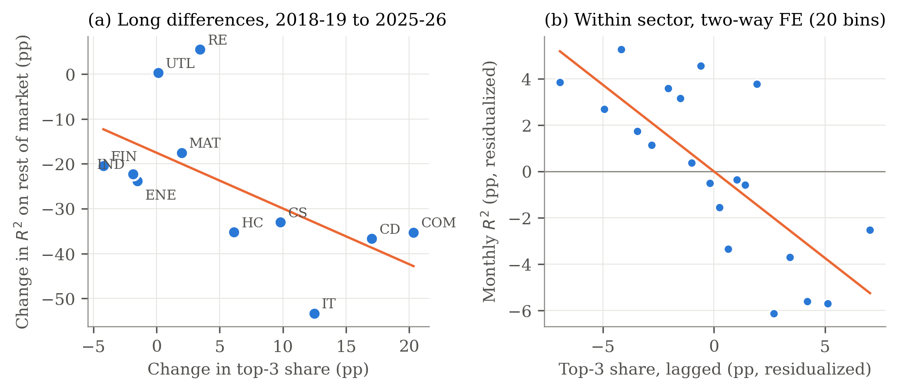
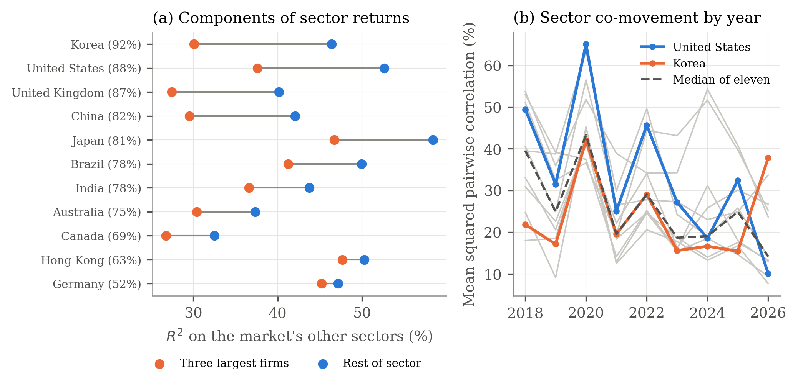

# Too Big to Co-Move

**Concentration and Sector Connectedness Around the World**

**Author:** Tanishk Yadav, New York University, Tandon School of Engineering\
**Status:** Working paper, October 2026. Not peer reviewed.\
**Paper, figures and summary:** [tanishkyadav.me/research/concentrated-sectors](https://www.tanishkyadav.me/research/concentrated-sectors)\
**Manuscript:** [`paper/v3/manuscript.pdf`](paper/v3/manuscript.pdf)



---

## Question

The ten largest firms rose from 24% to 41% of S&P 500 market capitalization between 2018 and 2025, and by August 2026 the eleven GICS sectors were less connected than at any point since the sample began in October 2018. Does concentration explain the disconnection, and what does it mean for a portfolio diversified across sectors?

## Key results

| Result | Value |
|---|---|
| Sample | 11 Select Sector SPDR funds, 1,989 trading days, 1 Oct 2018 to 31 Aug 2026; an uncapped constituent panel with point-in-time membership (78 since-removed firms recovered); constituent panels for ten other markets |
| Concentration and co-movement, uncapped U.S. returns, sector and month fixed effects | +1 pt top-3 share lowers monthly R² against the other ten sectors by 0.75 pts (wild cluster bootstrap p = 0.001, permutation p = 0.04) and average squared correlation by 0.26 pts (permutation p = 0.03) |
| Same, fund returns | Smaller coefficients, permutation p between 0.10 and 0.18: fund weight caps mute concentration where it is highest |
| Granular mechanism | A sector's three largest firms co-move less with the market than the rest of the sector in 91 of 99 U.S. sector-years, and in 78% of 933 sector-years across eleven markets |
| Other markets | The concentration link reappears in Japan, Canada and, more weakly, the United Kingdom, not in the other seven; it is strongest where sectors are deep and concentration rose |
| Does concentration explain the disconnection? | No. Holding each U.S. sector's top-3 weight at its 2018 level moves the system's average squared correlation by under 1 point against a 28-point fall (at most 2.1 points in any market); co-movement fell after 2025 in eight of eleven markets |
| Where the mega-caps sit | The top-3 firms of Communication Services, Consumer Discretionary and Information Technology have an average pairwise correlation of 0.49, against 0.16 for the rest of those sectors and 0.08 with the other eight sectors |
| Total connectedness, filtered TVP-VAR | Peak 88.9% (16 Mar 2020), sample low 53.7% (Aug 2026); a 200-day rolling window shows a spurious drop of more than 20 points when the April 2025 tariff shock leaves it |
| Net directional connectedness | Depends on how the variance decomposition is normalized: the concentration effect disappears under the scalar normalization of Caloia, Cipollini and Muzzioli (2019) and fails the permutation test (p from 0.19 to 0.49) |
| Lead-lag | Under GARCH errors the classical Granger F-test rejects a true null 21.0% of the time at a nominal 5% (30.7% when the lag is chosen by minimum p-value); robust tests leave none of 110 links, and lagged cross-sector returns have negative out-of-sample R² for every sector |

**Implication for portfolios:** a book diversified across GICS sectors in 2026 holds the same cluster of mega-caps through three sector funds, so diversification measured across sectors overstates diversification across the firms that carry the weight.

## Abstract

The ten largest firms rose from 24% to 41% of S&P 500 market capitalization between 2018 and 2025, and by August 2026 connectedness among the eleven GICS sectors had reached its lowest level in the sample. This paper asks whether concentration explains the disconnection, using daily returns of the Select Sector SPDR funds from October 2018 to August 2026, an uncapped constituent panel with point-in-time membership, a filtered TVP-VAR, and constituent panels for ten other major markets. Concentrated sectors co-move less with the rest of the market. On uncapped U.S. returns, a one-point rise in a sector's top-three share lowers its monthly R² against the other ten sectors by 0.75 points, and the result holds when concentration paths are randomly reassigned across sectors (p = 0.04). The mechanism is granular: in every market studied, a sector's three largest firms co-move less with the market than the rest of the sector, in 78% of 933 sector-years. The link between concentration and co-movement reappears in Japan, Canada and, more weakly, the United Kingdom, but not in the other seven markets; across markets it is strongest where sectors are deep and concentration rose. Everywhere, the shift in weight toward the largest firms is small in aggregate, and sector co-movement fell after 2025 in eight of eleven markets, including several where concentration fell. Net directional connectedness, the usual way to read such results, depends on how the variance decomposition is normalized and overstates the link. Concentration explains which sectors are least connected, not why markets disconnected.

**Keywords:** connectedness, market concentration, granularity, normalization, randomization inference, TVP-VAR\
**JEL:** C12, C23, C32, G12, L11



## Data

- **Sector returns:** the 11 Select Sector SPDR funds, daily log returns and Parkinson range volatility.
- **U.S. constituent panel:** point-in-time S&P 500 membership (78 since-removed firms recovered), historical share counts on a split-consistent basis, the March 2023 GICS reclassification on its effective date, and dual-class shares counted once. It gives within-sector concentration (top-3 share, Herfindahl index) and uncapped sector returns. The index top-10 share matches published figures within 1-3 points.
- **Why both:** the funds cap single-name weights, which mutes concentration exactly where it is highest; the uncapped series carries the main result.
- **Ten other markets:** current members of the TOPIX 500, CSI 300, FTSE 350, S&P/TSX Composite, KOSPI 200, S&P/ASX 200, NIFTY 50 and NIFTY Next 50, DAX and MDAX, Hang Seng and Ibovespa, mapped to the same eleven sectors and built the same way as the U.S. panel. Each rebuilt market is checked against its official index.
- **Source:** prices and share counts from Yahoo Finance via `yfinance`; index membership from Wikipedia's constituent lists (including S&P 500 additions and removals), the JPX TOPIX weight file, and the B3 Ibovespa portfolio.

## Methods

1. Filtered TVP-VAR connectedness (Antonakakis, Chatziantoniou and Gabauer 2020) with a forgetting-factor Kalman filter (Koop and Korobilis 2013), so each daily estimate uses only data available that day; static Diebold-Yilmaz (2012) connectedness as the benchmark.
2. Co-movement measured afresh each month: the R² of a sector's return on the equal-weighted return of the other sectors, and its average squared correlation with them.
3. Panel regressions on the lagged top-3 share with sector and month fixed effects. Inference built for slow-moving regressors: Driscoll-Kraay errors, a wild cluster restricted bootstrap by sector (Webb weights), and a permutation test that reassigns concentration paths across sectors.
4. Granular decomposition: each sector's return split into its three largest firms and the rest of the sector, and a counterfactual that holds the top-3 weight at its late-2018 level.
5. Normalization checks on the directional measures: row against scalar (maximum row-sum) normalization, and a covariance-only benchmark.
6. Lead-lag tests: Granger causality with heteroskedasticity-robust Wald tests and Benjamini-Hochberg FDR, a data-calibrated Monte Carlo for the size of the classical test, and out-of-sample predictability (Campbell-Thompson R², Clark-West test).
7. The same concentration, granular and counterfactual tests in each of the ten other markets, market by market and pooled.

## Reproducing

```bash
python -m venv .venv && source .venv/bin/activate
pip install -r requirements.txt

# United States
python src/build_panel.py              # data/panel/: fund and constituent returns, concentration
python src/econometrics.py             # connectedness, Granger, out-of-sample tests, panel regressions
python src/montecarlo_granger.py       # size of classical vs robust Granger tests under GARCH
python src/robust_panel.py             # panel robustness
python src/mechanism.py                # co-movement regressions
python src/fetch_top_firms.py          # data/firm/: top-3 and rest-of-sector components
python src/normalization_checks.py     # normalization and covariance-only benchmark
python src/inference_checks.py         # wild bootstrap and permutation inference
python src/granular_decomposition.py   # granular decomposition and counterfactual
python src/r2_robustness.py            # lags, HHI, leave-one-sector-out
python src/figures_v2.py && python src/figures_v3.py

# Ten other markets
python src/intl_universe.py            # data/intl/universe.csv
python src/intl_panel.py               # data/intl/panels/ (optionally name markets)
python src/intl_validate.py            # rebuilt markets against official indices
python src/intl_analysis.py            # current membership
python src/intl_analysis.py --fixed    # firms trading on the first sample day
python src/intl_heterogeneity.py
python src/intl_table.py
python src/figures_intl.py             # writes paper/v3/fig/
```

Results land in `output/v2/`, `output/v3/` and `output/intl/`; `output/v3/summary.json` and `output/intl/pooled.json` hold the headline numbers.

## Project structure

```
src/
  build_panel.py, econometrics.py, montecarlo_granger.py, robust_panel.py, mechanism.py
                           U.S. panel, connectedness, lead-lag tests, co-movement regressions
  fetch_top_firms.py, granular_decomposition.py
                           top-3 and rest-of-sector components, counterfactual
  normalization_checks.py, inference_checks.py, r2_robustness.py
                           normalization, persistent-regressor inference, robustness
  intl_*.py                ten other markets: universes, panels, validation, tests, tables
  figures_v2.py, figures_v3.py, figures_intl.py
                           manuscript figures
data/                      reference files and built panels (raw vendor data gitignored)
output/                    results (v2: connectedness and lead-lag; v3: co-movement; intl: other markets)
paper/v3/                  manuscript and figures
```

## Cite

Yadav, Tanishk (2026). "Too Big to Co-Move: Concentration and Sector Connectedness Around the World." Working paper, New York University.

## License

MIT
